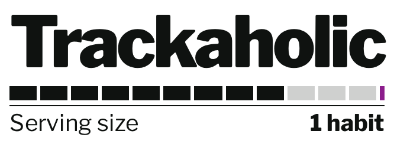
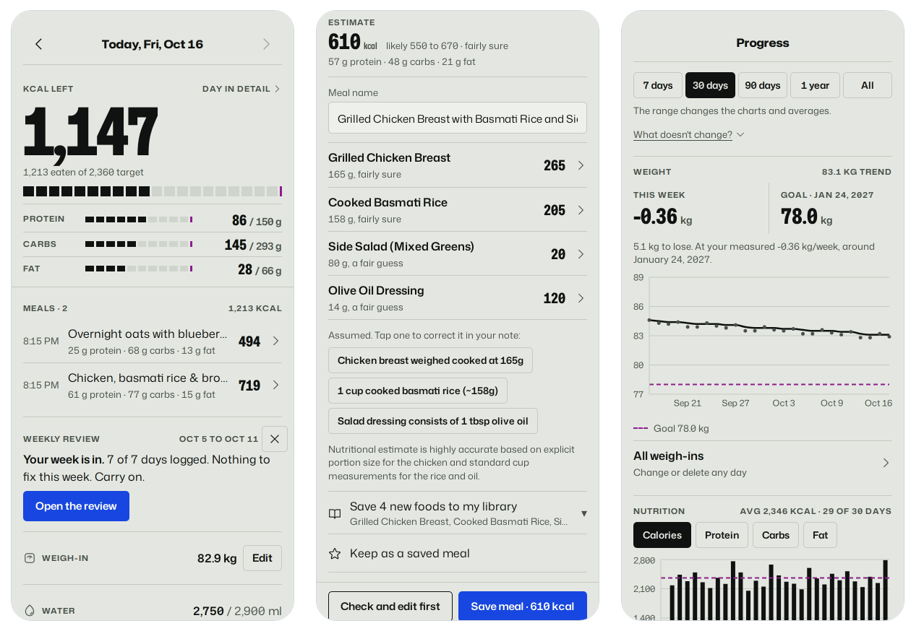

<h1 align="center">
  <picture>
    <source media="(prefers-color-scheme: dark)" srcset="screenshots/wordmark-dark.png">
    
  </picture>
</h1>

<b>A calorie and macro tracker that estimates a meal from a photo, a voice note or a sentence, and tells you how sure it is.</b>

  <a href="https://trackaholic.app"><b>Open the app</b></a> ·
  <a href="https://story.trackaholic.app/?ref=gh-readme">The story so far</a> ·
  <a href="#read-more">Docs</a> ·
  <a href="#engineering-notes">Engineering notes</a>
   
  Free hosting: the first visit after a quiet spell can take 30–60 s while the server wakes up.

  
  

  <picture>
    <source media="(prefers-color-scheme: dark)" srcset="screenshots/hero-dark.png">
    
  </picture>

## Highlights

<table>
<tr>
<td valign="top" width="50%">

🔍 **[AI analysis was down for three days](docs/incident-2026-07-gemini-eea-region.md)**

Six hypotheses were ruled out before the real one: Gemini's free tier is geo-blocked in the EEA, and the server was in Frankfurt.

</td>
<td valign="top" width="50%">

📐 **[Photo size chosen by an A/B test](docs/photo-size-ab-2026-10.md)**

1024 px moved the model's estimates upward, so 1536 px shipped. The AI bill turned out not to depend on photo size at all.

</td>
</tr>
<tr>
<td valign="top">

✅ **[1,700+ tests, six CI gates](https://github.com/Abdulla1x/Trackaholic/actions/workflows/ci.yml)**

1,544 backend and 190 frontend, including a cross-account suite that checks no user can read another's data.

</td>
<td valign="top">

🏗️ **[Multi-user, in production](docs/architecture.md)**

FastAPI + PostgreSQL behind a React PWA, with migrations, nightly backups and AI quotas sized to a free tier.

</td>
</tr>
</table>

## What it does

- **Log a meal from a photo, a voice note or a sentence.** The AI returns a calorie range, how sure it is, and every assumption it made, so you can correct it before saving.
- **Or type it.** Ingredients fill in from your own food library, five national food tables (USDA, UK, France, Australia, Canada) and Open Food Facts.
- **A daily target worked out from you**: your body, then your real burn, measured from your own weigh-ins and logs.
- **Progress over any range**: weight trend, goal date and nutrition charts, from 7 days to all time.
- **A weekly review** computed from the week you actually logged.
- **Optional trackers** for water, steps (with a Samsung Health import) and supplements, plus calorie banking across the week.
- **Saved meals, copy a recent meal, share a meal by code.**
- **Installs on your phone as an app**, nine colour palettes in light and dark, and your data is yours: meals out as CSV, everything as JSON.

Everything, in detail: [docs/features.md](docs/features.md).

## Engineering notes

- [**AI meal analysis down for three days**](docs/incident-2026-07-gemini-eea-region.md) — a
  post-mortem. The feature failed for every input; the API key was valid, the model existed,
  and the deployed code worked fine from a laptop. Six hypotheses were eliminated before the
  real one: Gemini's free tier is geo-blocked in the EEA, and the backend was hosted in
  Frankfurt. Covers the diagnosis, the region migration, what remains unproven, and the two
  further failures the migration caused.
- [**Picking a photo size with an A/B instead of a hunch**](docs/photo-size-ab-2026-10.md) —
  the plan was to shrink photos to 1024 px because "the model downsamples anyway". Measured
  first: the AI bill turned out not to depend on photo size at all, and 1024 px shifted the
  model's estimates upward on every plate it changed. Covers the experiment design (run
  against the model's own run-to-run noise), why 1536 px shipped instead, and exactly what
  the numbers can and cannot claim.
- [**Setting a calorie target from sources, not round numbers**](docs/goal-setting-rules.md) —
  every rule behind a day-one target checked against a primary source before the first-use
  screens were built. Five proposed rules didn't survive and were replaced; the activity
  multipliers turned out to be a decades-old convention that set desk workers' targets too
  low; and four everyday gaps turned up, from a goal weight that changed nothing to typed
  macros that couldn't add up. Covers each rule with its source, three decisions in detail,
  how it's tested, and where a competitor is still ahead.

## Read more

| | |
|---|---|
| [All features](docs/features.md) | everything the app does, in detail |
| [Screenshots](docs/screenshots.md) | every screen, phone and desktop, light and dark |
| [Install it on your phone](docs/install.md) | iPhone, Android, desktop |
| [Architecture](docs/architecture.md) | how the frontend, API, database and AI fit together |
| [Running locally](docs/development.md) | setup, tests and the six CI gates |
| [Deployment](docs/deployment.md) | Neon, Render and Vercel, and keeping the free server awake |
| [API](docs/api.md) | every endpoint |
| [Data sources and credits](docs/data-sources.md) | the food tables, fonts and icons, and their licences |

## Built with

React 19 + TypeScript 6 (an installable PWA) · Python 3.14 + FastAPI + SQLAlchemy · PostgreSQL on Neon, with Alembic migrations · Gemini for the meal estimates · hosted on Vercel and Render.

*Formerly **Macros Calculator**; renamed in October 2026, and moved from `macros-calculator-mu.vercel.app` to `trackaholic.app` the same month. It started as a Streamlit app, which lives on in [`legacy/`](legacy/).*

## Licence and contributing

[MIT](LICENSE). Contributions are welcome. Read [CONTRIBUTING.md](CONTRIBUTING.md) first: opening a pull
request means agreeing to its licence terms. Your contribution is MIT-licensed, and I may also
relicense it in the future.

**Abdulla** · [github.com/Abdulla1x](https://github.com/Abdulla1x)
