[← Back to the README](../README.md)

# 📸 Screenshots

Every screen at both widths, in light or dark to match your GitHub theme. Each image is one long capture of the **entire page**, top to bottom — not the part that happens to fit above the fold.

> 🔍 **Click any screenshot to open it full size.**
> Because each one is a whole page, it is scaled down to fit here and runs past the bottom of your screen. What you can see without scrolling is not the end of it.

## Today

What's left of today's calories, protein, carbs and fat, then the meals you've logged. Below them: the week's review when it's ready, and the trackers you chose — weigh-in, water, steps, supplements.

<table>
<tr><th align="center">Desktop</th><th align="center">Phone</th></tr>
<tr>
<td valign="top" align="center"><a href="../screenshots/light/desktop/today.png"><picture><source media="(prefers-color-scheme: dark)" srcset="../screenshots/dark/desktop/today.png">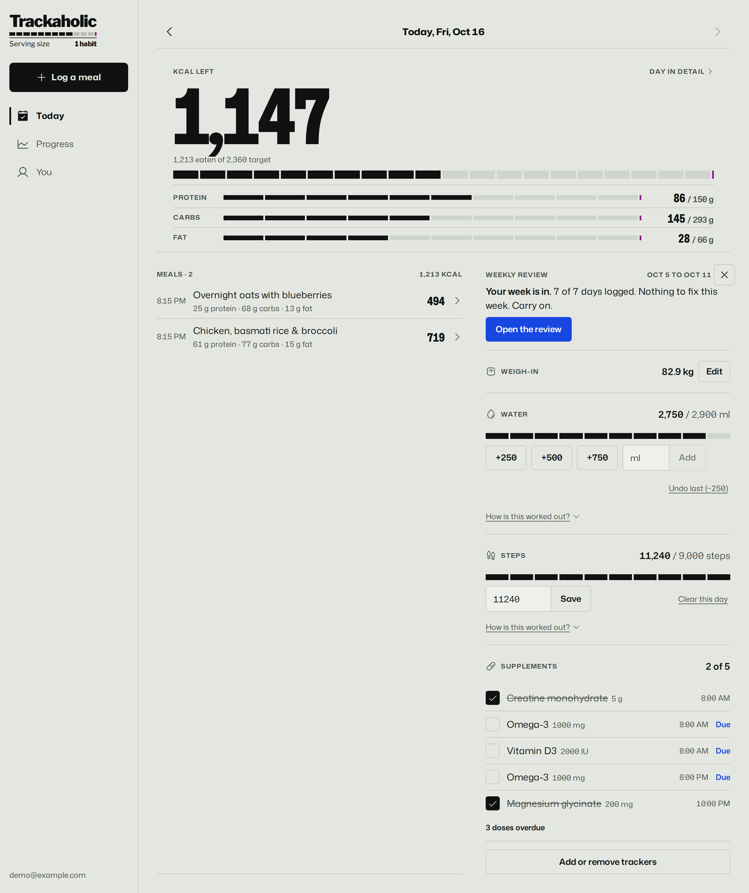</picture></a></td>
<td valign="top" align="center"><a href="../screenshots/light/mobile/today.png"><picture><source media="(prefers-color-scheme: dark)" srcset="../screenshots/dark/mobile/today.png">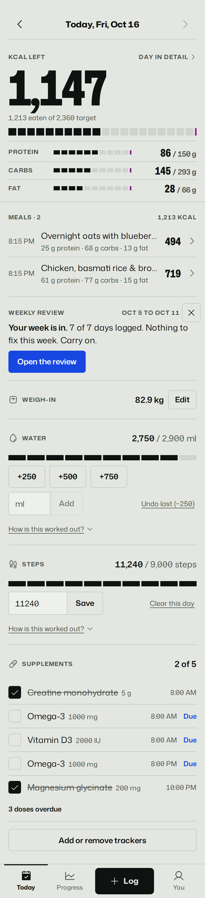</picture></a></td>
</tr>
</table>

Whole page, scaled down — click either image to view it full size.

## Estimate a meal with AI

Log is a panel over whatever you're looking at. Describe the meal, speak it or photograph it. The estimate comes back as a range with how sure it is, each ingredient with its own confidence, and every assumption listed so you can correct it in your note. Save it in one tap, or check it first.

<table>
<tr><th align="center">Desktop</th><th align="center">Phone</th></tr>
<tr>
<td valign="top" align="center"><a href="../screenshots/light/desktop/ai-analysis.png"><picture><source media="(prefers-color-scheme: dark)" srcset="../screenshots/dark/desktop/ai-analysis.png">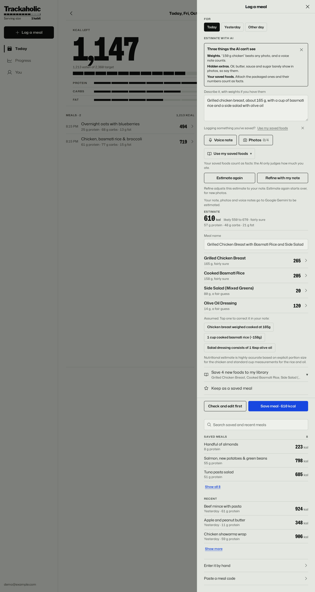</picture></a></td>
<td valign="top" align="center"><a href="../screenshots/light/mobile/ai-analysis.png"><picture><source media="(prefers-color-scheme: dark)" srcset="../screenshots/dark/mobile/ai-analysis.png">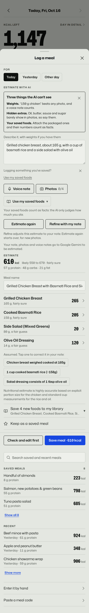</picture></a></td>
</tr>
</table>

Whole page, scaled down — click either image to view it full size.

## Check and edit first

Nothing is saved until you've looked at it. The ingredients arrive as ordinary rows you can correct, and any of them can go into your food library for next time.

<table>
<tr><th align="center">Desktop</th><th align="center">Phone</th></tr>
<tr>
<td valign="top" align="center"><a href="../screenshots/light/desktop/ai-applied.png"><picture><source media="(prefers-color-scheme: dark)" srcset="../screenshots/dark/desktop/ai-applied.png">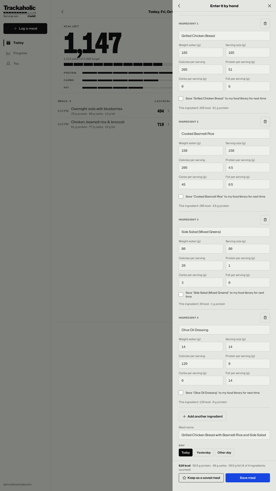</picture></a></td>
<td valign="top" align="center"><a href="../screenshots/light/mobile/ai-applied.png"><picture><source media="(prefers-color-scheme: dark)" srcset="../screenshots/dark/mobile/ai-applied.png">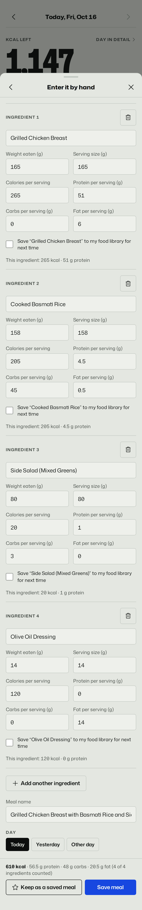</picture></a></td>
</tr>
</table>

Whole page, scaled down — click either image to view it full size.

## Enter it by hand

Type an ingredient and your food library fills in the macros, with generic foods from the national food tables listed under it as you type, and an Open Food Facts lookup for packaged products.

<table>
<tr><th align="center">Desktop</th><th align="center">Phone</th></tr>
<tr>
<td valign="top" align="center"><a href="../screenshots/light/desktop/log-meal.png"><picture><source media="(prefers-color-scheme: dark)" srcset="../screenshots/dark/desktop/log-meal.png">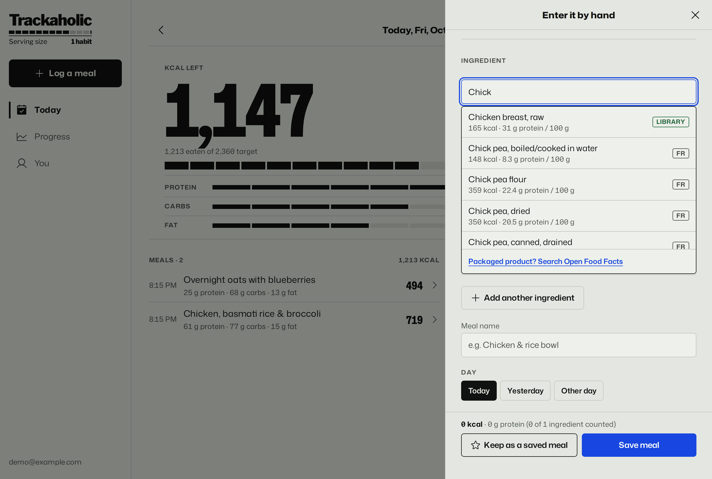</picture></a></td>
<td valign="top" align="center"><a href="../screenshots/light/mobile/log-meal.png"><picture><source media="(prefers-color-scheme: dark)" srcset="../screenshots/dark/mobile/log-meal.png">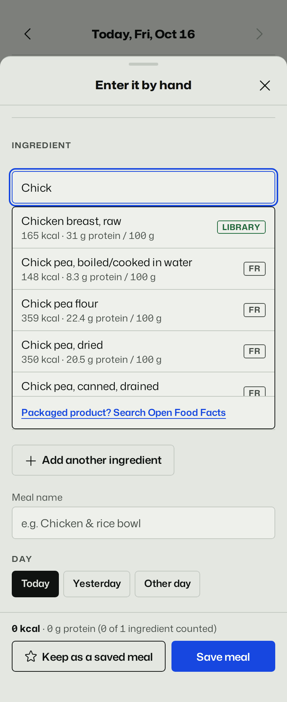</picture></a></td>
</tr>
</table>

Whole page, scaled down — click either image to view it full size.

## Progress

Weight as a trend line rather than daily noise, with the weekly rate and when you'll reach your goal at that rate. Then calories and each macro per day, and the daily burn measured from your own weigh-ins and logging.

<table>
<tr><th align="center">Desktop</th><th align="center">Phone</th></tr>
<tr>
<td valign="top" align="center"><a href="../screenshots/light/desktop/progress.png"><picture><source media="(prefers-color-scheme: dark)" srcset="../screenshots/dark/desktop/progress.png">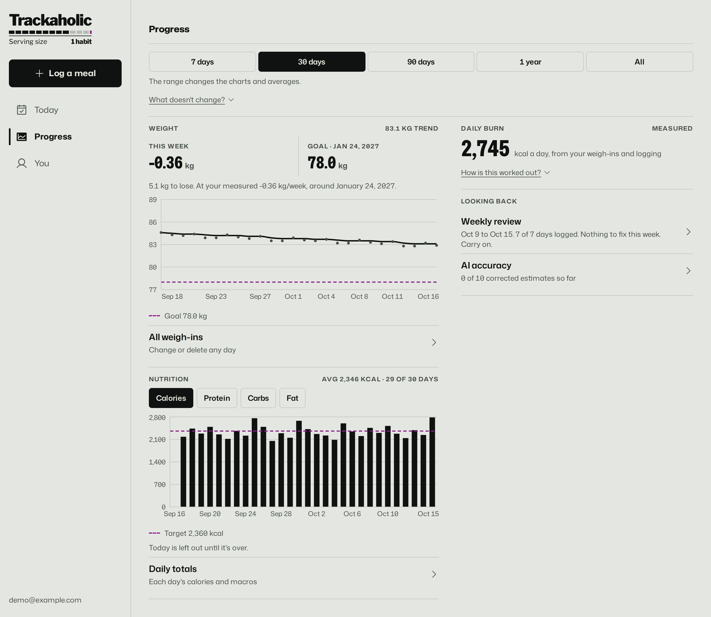</picture></a></td>
<td valign="top" align="center"><a href="../screenshots/light/mobile/progress.png"><picture><source media="(prefers-color-scheme: dark)" srcset="../screenshots/dark/mobile/progress.png">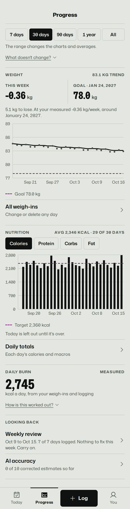</picture></a></td>
</tr>
</table>

Whole page, scaled down — click either image to view it full size.

## Weekly review

A computed check for each thing you track. Each one names the number, what it's compared with, and how many days it was worked out from. The AI can put them into words, without adding numbers of its own.

<table>
<tr><th align="center">Desktop</th><th align="center">Phone</th></tr>
<tr>
<td valign="top" align="center"><a href="../screenshots/light/desktop/review.png"><picture><source media="(prefers-color-scheme: dark)" srcset="../screenshots/dark/desktop/review.png">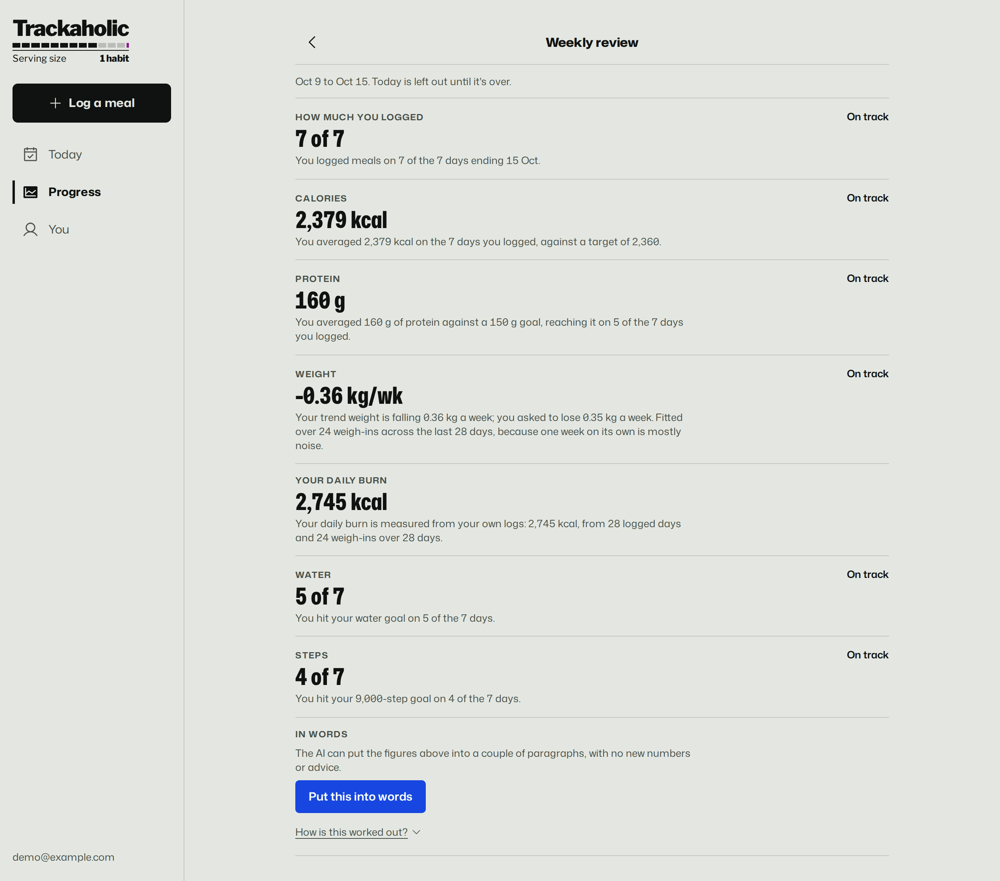</picture></a></td>
<td valign="top" align="center"><a href="../screenshots/light/mobile/review.png"><picture><source media="(prefers-color-scheme: dark)" srcset="../screenshots/dark/mobile/review.png">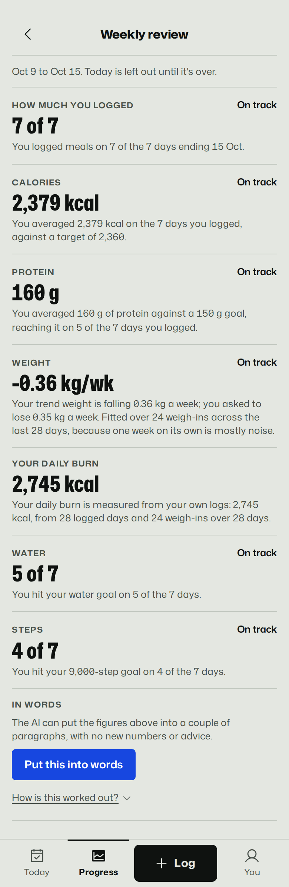</picture></a></td>
</tr>
</table>

Whole page, scaled down — click either image to view it full size.

## How your target is worked out

Every step from your body to your daily target, with the arithmetic shown and the sources listed. Once there's enough data, the measured burn replaces the formula's guess.

<table>
<tr><th align="center">Desktop</th><th align="center">Phone</th></tr>
<tr>
<td valign="top" align="center"><a href="../screenshots/light/desktop/target.png"><picture><source media="(prefers-color-scheme: dark)" srcset="../screenshots/dark/desktop/target.png">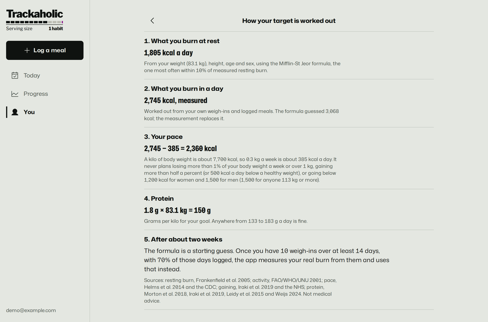</picture></a></td>
<td valign="top" align="center"><a href="../screenshots/light/mobile/target.png"><picture><source media="(prefers-color-scheme: dark)" srcset="../screenshots/dark/mobile/target.png">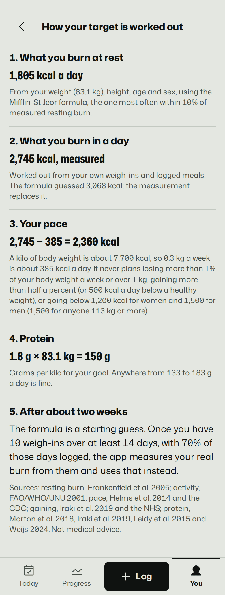</picture></a></td>
</tr>
</table>

Whole page, scaled down — click either image to view it full size.

## You

Targets, body and goal weight, trackers, your food library and saved meals, appearance, and your data, all on one page, each a tap away.

<table>
<tr><th align="center">Desktop</th><th align="center">Phone</th></tr>
<tr>
<td valign="top" align="center"><a href="../screenshots/light/desktop/you.png"><picture><source media="(prefers-color-scheme: dark)" srcset="../screenshots/dark/desktop/you.png">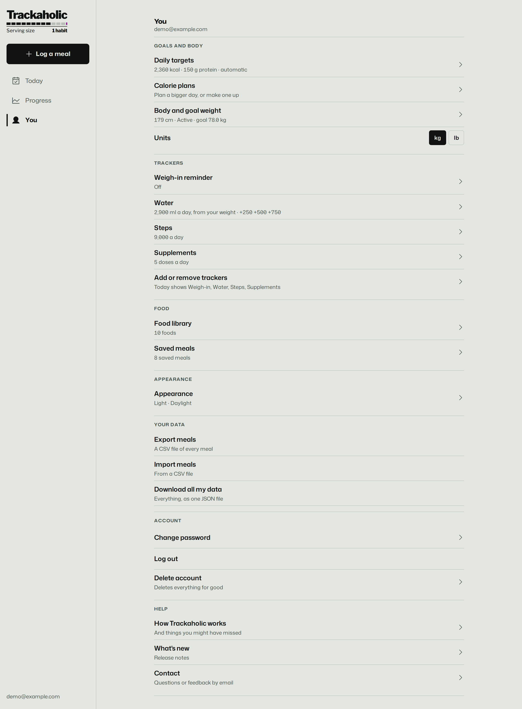</picture></a></td>
<td valign="top" align="center"><a href="../screenshots/light/mobile/you.png"><picture><source media="(prefers-color-scheme: dark)" srcset="../screenshots/dark/mobile/you.png">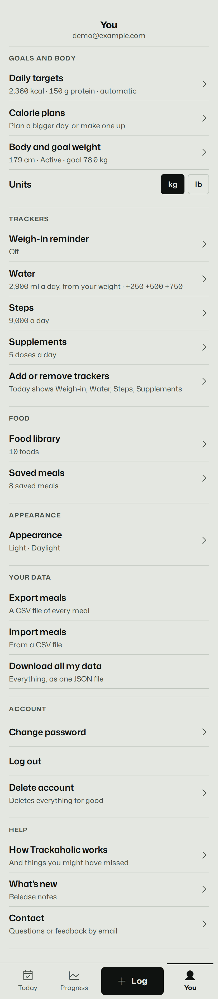</picture></a></td>
</tr>
</table>

Whole page, scaled down — click either image to view it full size.
